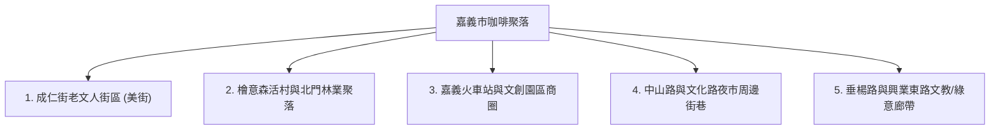

# 嘉義市咖啡廳地理聚落與區域分布解析

嘉義市面積不大（約 60 平方公里），但咖啡廳密度高居全台前茅。早期作為阿里山林業開發樞紐的「木都」歷史，留下了上千棟日治時期檜木官舍、戰後街屋、老醫館與印刷廠。

從我們知識庫收錄的 30 多間指標店來看，嘉義市咖啡廳呈現非常明顯的**「4 大核心聚落 ＋ 2 大外圍特色廊帶」**分佈格局：

---

## 🗺️ 嘉義市咖啡廳 4 大核心聚落

---

### 1. 成仁街聚落（古稱「美街」）：老宅與文青密度最高的一條街
* **歷史背景**：成仁街早期因詩人、書法家、畫家與裝裱裱畫店雲集，有「嘉義美街」之美稱，街道保留了極多日治至民國初期的雙層木造老屋與戰後水泥街屋。
* **氛圍特色**：走幾步就是一間咖啡廳，風格多走低調、日式木造與文藝復古路線，是嘉義徒步跑店的「第一戰區」。
* **代表店家**：
  - [[HERMIT & Co.]]（百年永成印刷廠、預約制榻榻米和室）
  - [[二屾Ershen]]（復古綠木門、老花磚與手作戚風）
  - [[新華美西裝社]]（一甲子黑色木造西裝店、日式烤糰子與咖哩）
  - [[木更MUGN]]（戰後老宅結合清水模、設計選品與蜂巢戚風）

---

### 2. 檜意森活村與北門車站聚落：林業官舍與京都風情
* **歷史背景**：日治時期阿里山森林鐵路運材的終點站（北門驛），周邊留存全台灣保存最完整、腹地最大的日式官舍群（檜意森活村）。
* **氛圍特色**：充滿濃郁的日式京都感、檜木香氣與林業歷史氛圍，多有庭園造景。
* **代表店家**：
  - [[Morikoohii森咖啡]]（檜意森活村 T12 官舍、經典日式煎鬆餅與宇治金時刨冰）
  - [[寓製作ApātoCrafted]]（共和路百年日治宿舍、長崎雙糖顆粒蜂蜜蛋糕、極簡侘寂）
  - [[常常TheFrequent]]（忠孝路近北門車站、午後自然光影、法式聖多諾黑與鹹派）

---

### 3. 嘉義火車站與文創園區商圈：老酒廠與返鄉青年聚集地
* **歷史背景**：以嘉義火車站為中心，延伸至一旁的「嘉義文化創意產業園區（嘉義舊酒廠）」，交通極度便利，是許多旅人抵達嘉義後的第一站。
* **氛圍特色**：結合了大型工業風倉庫挑高改造、鐵道景觀，以及青年創業的故事感。
* **代表店家**：
  - [[國王蝴蝶咖啡RoiCafe]]（舊酒廠 F 棟 2 樓挑高倉庫、酒紅簾幔與東市米麩拿鐵）
  - [[小口品s]]（光彩街上、從小木攤車起家的自烘專業手沖與溫馨故事牆）
  - [[Dailycafé日日珈啡]]（秀泰影城後方鐵道旁、日夜雙面貌日間咖啡夜間酒吧）

---

### 4. 中山路與文化路夜市周邊街巷：外帶吧與深夜咖啡戰場
* **歷史背景**：嘉義市區最繁華的商業核心（中央噴水圓環、文化路夜市、北榮街、蘭井街、國華街）。
* **氛圍特色**：白天是熱鬧的街邊外帶吧與老屋甜點店，入夜後則轉化為深夜咖啡與夜貓子聚落，藏在古蹟或老市街巷弄轉角。
* **代表店家**：
  - [[霜空珈琲]]（國華街老診所、侘寂美學點心盤、安靜典雅）
  - [[Supiidoスピード]]（仁武宮 300 年古蹟旁、街角日系木造外帶吧）
  - [[KoffeeSuika西瓜珈琲]]（北榮街 70 年老米店改建、門口長凳與西瓜美式）
  - [[木商珈琲]]（東市場旁蘭井街雙層老洋房、烈日鬆餅與布丁）
  - [[秘氏咖啡]]（延平街近百年老屋、1960 昭和小津安二郎電影感、營業至 21:00）
  - [[巴倫司康BaronScones]]（公明路老宅、現烤英式司康專賣）
  - [[藏咖啡CANGKaFei]]（中山路上平價千層蛋糕、插座充足、營業至 22:00）

---

## 🌿 2 大特色廊帶（文教、綠意與工業廠房）

### A. 興業東路 ✕ 嘉義公園廊帶：洋房庭院與綠意採光
* **特色**：靠近嘉義公園與體育場，空間比市中心更為開闊，多為獨立洋房、大片玻璃溫室或綠意包圍的老屋。
* **代表店家**：
  - [[荏苒咖啡]]（嘉義公園旁暖色老宅、家常熱燉湯鹹食與肉桂捲）
  - [[曉咖啡InChiayi]]（興業東路獨立洋房庭院、營業至 22:00 不限時、深焙手沖）
  - [[玖CAFÉ]]（興業東路老宅紅磚結合挑高玻璃溫室採光、氮氣冷萃）
  - [[CoffeeSoulution珈琲解方]]（安樂街清幽老宅、職人 SOE 濃縮）

### B. 垂楊路 ✕ 興中街廊帶：直火硬派工業風與公園自烘店
* **特色**：鄰近新光三越商圈與文化公園，以自家烘焙老店與大膽工業風見長，營業時間長且適合工作。
* **代表店家**：
  - [[SENSMO咖啡感獸]]（垂楊路冷調金屬水泥風、直火烘豆、早八一路開到午夜 00:00）
  - [[往前咖啡製作所]]（興中街老鐵工廠圓拱挑高廠房、自家專業烘焙）
  - [[聖塔咖啡SantaCoffee]]（文化公園旁老牌自烘豆、富士皇家烘豆機）
  - [[弓箭手ArchersKitchen]]（永安街崇文公園旁深色歐風復古老洋房、手工布丁）
  - [[DAYDAY選物咖啡]]（番仔溝公園內獨立小木屋、秘密客二店、選物雜貨至午夜）

---

## 🚶 散策路線建議

1. **經典老屋徒步線（半日步行最精華）**：
   - 路線：嘉義火車站 → [[國王蝴蝶咖啡RoiCafe]] → 走入成仁街：[[二屾Ershen]] / [[HERMIT & Co.]] / [[木更MUGN]] → 轉角到北榮街 [[Supiidoスピード]] 喝外帶杯。
2. **極致寧靜放空線（適合一人沉思）**：
   - 路線：午後來到國華街 [[霜空珈琲]] 品嚐點心盤 → 傍晚漫步至延平街 [[秘氏咖啡]] 喝 KONO 點滴深焙手沖或至興業東路 [[曉咖啡InChiayi]] 待到夜晚。
3. **早起跑店 / 夜貓子深夜線**：
   - 早上 08:00 到 [[SENSMO咖啡感獸]] 或 [[Supiidoスピード]] 喝早晨第一杯咖啡。
   - 晚上 20:00 後造訪 [[SENSMO咖啡感獸]]（至00:00）、[[Dailycafé日日珈啡]]（至00:00）、[[曉咖啡InChiayi]]（至22:00）或 [[藏咖啡CANGKaFei]]（至22:00）。
